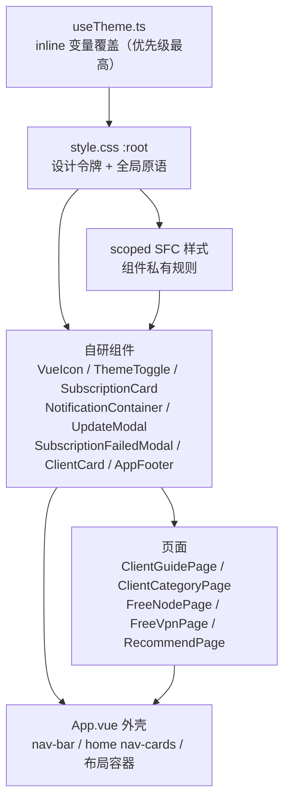

# DESIGN.md — CtelSpecu Ladders 设计系统

本文件记录本项目**实际生效**的配色、样式约定与自研组件。所有数值均来自源码，标注 `文件:行号`；未在源码中出现的内容一律不写。

## 0. 读前须知

- 项目没有 CSS 框架、没有预处理器、没有 Tailwind。全部是手写 CSS + CSS 自定义属性（CSS Variables）。
- **主题真相源是 `src/composables/useTheme.ts`**，不是 `src/style.css` 里的 `.theme-light`。运行时它会把调色板以 inline style 写到 `<html>`，inline 优先级高于任何样式表规则。见 §4.3。
- 视觉语言关键词：`aurora glass`（极光 + 玻璃拟态）、`orb blob`（卡片右上角的紫/玫瑰模糊光斑）、`gradient text`（渐变裁切标题）、`bento`（推荐页网格）。
- 动效主调：卡片 `0.5s cubic-bezier(0.4,0,0.2,1)`，控件 `250ms`，位移 `-1px ~ -4px`。

---

## 1. 技术栈与渲染模型

| 项 | 值 | 来源 |
|---|---|---|
| 框架 | Vue 3.2，全部 `<script setup lang="ts">` | `package.json` |
| 构建 | Vite 4 + `vue-tsc` 类型检查 | `package.json` |
| 图标 | Font Awesome Free 6.7（`fontawesome.css` + `solid.css` + `brands.css`） | `src/main.ts:3-5` |
| 样式作用域 | 每个 SFC 自带 `<style scoped>`；全局只有 `src/style.css` | 全仓库 |
| 主题切换 | `<html>` 上的 `theme-dark` / `theme-light` 类 + inline CSS 变量 | `useTheme.ts:34-52` |
| 深色/浅色默认 | **深色为默认**（无本地存储时 `isDark = true`） | `useTheme.ts:19` |
| 路由 | 无 vue-router，手写 hash 路由（`#/subscriptions` 等） | `App.vue:215-232` |

---

## 2. 分层架构



约定：**令牌在 `:root`，组件只消费 `var(--*)`**。新增颜色必须先进 `:root` + `.theme-light` + `useTheme.ts` 三处（见 §15 第 1 条）。

---

## 3. 设计基调

| 维度 | 取向 | 证据 |
|---|---|---|
| 密度 | 中低密度，卡片内 `18~28px` 内边距，栅格 `16~24px` 间距 | `App.vue:886`、`SubscriptionCard.vue:698` |
| 圆角 | 大圆角：卡片 `18px`，大卡片/模态 `22px`，胶囊 `999px` | `style.css:138-143` |
| 阴影 | 双层阴影（近距硬 + 远距软），悬停时升级并染色 | `style.css:79-105` |
| 边框 | 极低对比度 `rgba(255,255,255,0.10)`，悬停时才染色 | `style.css:108-113` |
| 玻璃 | `backdrop-filter: blur(10~20px)` + `saturate(1.08~1.15)` | `App.vue:737-738` |
| 文字 | 标题 `800` 配负字距（`-0.025em ~ -0.03em`），正文 `400/500` | `App.vue:871`、`ClientGuidePage.vue:68` |

---

## 4. 色彩系统

### 4.1 深色（`:root`，默认）

来源：`src/style.css:1-152`。

| 令牌 | 值 | 用途 |
|---|---|---|
| `--background-primary` | `#0f0f0f` | 页面底色 |
| `--background-primary-alt` | `#1a1a1a` | 滚动条槽、次级底 |
| `--background-secondary` | `#1e1e1e` | 卡片 / 面板默认底 |
| `--background-secondary-alt` | `#252525` | 表头、更高一层 |
| `--background-tertiary` | `#2a2a2a` | 内嵌块（指标区、图标底座、输入框） |
| `--background-trans` | `rgba(255,255,255,0.08)` | 轨道 / 半透明填充 |
| `--background-glass` | `rgba(30,30,30,0.7)` | 导航、页面外壳玻璃 |
| `--surface-hover` | `rgba(255,255,255,0.06)` | 行/胶囊悬停底 |
| `--text-bright` | `#ffffff` | 按钮文字、渐变底 |
| `--text-primary` | `#e0e0e0` | 正文主色 |
| `--text-secondary` | `#b0b0b0` | 说明文字 |
| `--text-tertiary` | `#808080` | 弱化说明、占位符 |
| `--text-quaternary` | `#606060` | 箭头、脚注 |
| `--text-accent` | `#00d4ff` | 主强调（青） |
| `--text-sub-accent` | `#ff006e` | 副强调（洋红） |
| `--text-gradient-secondary` | `#7c3aed` | 渐变中段（紫） |
| `--text-link` / `-hover` / `-active` | `#00d4ff` / `#00b8e6` / `#0099cc` | 链接 |
| `--text-success` | `#22c55e` | 成功 / 可用 |
| `--text-error` | `#ef4444` | 失败 / 过期 |
| `--text-warning` | `#fbbf24` | 重试 / 警告 |
| `--text-info` | `#3b82f6` | 提示 |
| `--border-primary` | `rgba(255,255,255,0.10)` | 常规边框 |
| `--border-secondary` | `rgba(255,255,255,0.06)` | 内嵌边框 |
| `--border-strong` | `rgba(255,255,255,0.16)` | 强调边框 |
| `--orb-violet` | `rgb(168,85,247)` | 卡片左上光斑 |
| `--orb-rose` | `rgb(253,164,175)` | 卡片右上光斑 |
| `--orb-opacity` | `0.92` | 光斑不透明度 |
| `--orb-blur` | `14px` | 光斑模糊（**当前未被引用**） |

> 带 `-rgb` 后缀的三元组（`--accent-rgb: 0,212,255`、`--sub-accent-rgb: 255,0,110`、`--success-rgb`、`--warning-rgb`、`--error-rgb`）专供 `rgba(var(--accent-rgb), 0.12)` 这种带透明度的写法使用。

### 4.2 浅色（样式表版，`.theme-light`）

来源：`src/style.css:153-208`。**注意：多数值会被 §4.3 覆盖，这里仅作设计意图记录。**

| 令牌 | 值 |
|---|---|
| `--background-primary` | `#f6f7f9`（暖中性，刻意避开纯白） |
| `--background-secondary` | `#ffffff` |
| `--background-tertiary` | `#e9ecef` |
| `--background-glass` | `rgba(255,255,255,0.82)` |
| `--text-bright` | `#0b0e14` |
| `--text-primary` | `#1a1d23` |
| `--text-secondary` | `#4a505c` |
| `--text-tertiary` | `#6b7280` |
| `--text-accent` | `#0b6bff`（`11,107,255`） |
| `--text-sub-accent` | `#d61a6c`（`214,26,108`） |
| `--border-primary` | `rgba(12,17,29,0.10)` |
| `--orb-opacity` | `0.58`（浅色下光斑减淡） |

### 4.3 运行时覆盖（真正生效的调色板）

来源：`src/composables/useTheme.ts:53-171`。写在 `document.documentElement.style` 上。

| 令牌 | 深色 | 浅色（实际生效） |
|---|---|---|
| `--background-primary` | `#0f0f0f` | `#ffffff` |
| `--background-primary-alt` | `#1a1a1a` | `#f8f9fa` |
| `--background-secondary` | `#1e1e1e` | `#f8f9fa` |
| `--background-secondary-alt` | `#252525` | `#e9ecef` |
| `--background-tertiary` | `#2a2a2a` | `#dee2e6` |
| `--background-glass` | `rgba(30,30,30,0.7)` | `rgba(255,255,255,0.7)` |
| `--text-bright` | 未设置（沿用 `#ffffff`） | `#000000` |
| `--text-primary` | `#e0e0e0` | `#212529` |
| `--text-secondary` | `#b0b0b0` | `#495057` |
| `--text-tertiary` | `#808080` | `#6c757d` |
| `--text-quaternary` | `#606060` | `#adb5bd` |
| `--text-accent` | `#00d4ff` | `#0066cc` |
| `--text-sub-accent` | `#ff006e` | `#cc0066` |
| `--text-link` / hover / active | `#00d4ff` / `#00b8e6` / `#0099cc` | `#0066cc` / `#0052a3` / `#003d80` |
| `--border-primary` | `rgba(255,255,255,0.1)` | `rgba(0,0,0,0.1)` |
| `--border-secondary` | `rgba(255,255,255,0.05)` | `rgba(0,0,0,0.05)` |
| `--soft-shadow` | `0 4px 6px -1px rgba(0,0,0,.1), 0 2px 4px -1px rgba(0,0,0,.06)` | 同左 |
| `--accent-shadow` | `0 25px 50px -12px rgba(0,212,255,.25), 0 20px 25px -5px rgba(0,212,255,.1)` | `rgba(0,102,204,...)` 同构 |
| `--sub-accent-shadow` | `rgba(124,58,237,.25)` / `.1`（**紫色，非洋红**） | `rgba(102,51,204,...)` |

**关键结论**：浅色模式的实际主色是 `#0066cc`，不是样式表写的 `#0b6bff`；实际背景是纯白 `#ffffff`，不是 `#f6f7f9`。改配色请先改 `useTheme.ts`。

### 4.4 渐变

| 令牌 | 值（深色） | 用途 |
|---|---|---|
| `--main-gradient` | `linear-gradient(135deg, #00d4ff 0%, #7c3aed 35%, #ff006e 70%, #ff6b35 100%)` | 标题裁切、主按钮、进度条、滚动条 |
| `--strong-gradient` | `linear-gradient(45deg, #00d4ff 0%, #7c3aed 50%, #ff006e 100%)` | 悬停态加深 |
| `--sub-gradient` | `linear-gradient(90deg, rgba(0,212,255,.2), rgba(124,58,237,.2), rgba(255,0,110,.2))` | 卡片悬停洗色（`::before` + `opacity`） |

浅色版：`#0b6bff → #6d28ff → #d61a6c → #ff6b35`（样式表）/ `#0066cc → #6633cc → #cc0066 → #cc6633`（运行时）。

### 4.5 阴影与辉光

> 下表是样式表值。深色模式下 `useTheme.ts` 会覆写三个阴影令牌，其中有一处**语义漂移**：
> - `--soft-shadow` → `0 4px 6px -1px rgba(0,0,0,.1), 0 2px 4px -1px rgba(0,0,0,.06)`（比样式表更硬，多数卡片实际用这个）
> - `--accent-shadow` → 与样式表一致（青色 `rgba(0,212,255,...)`）
> - `--sub-accent-shadow` → **紫色** `rgba(124,58,237,.25)`，而不是样式表里的洋红 `rgba(255,0,110,.25)`

| 令牌 | 深色值 |
|---|---|
| `--soft-shadow` | `0 4px 20px rgba(0,0,0,.22), 0 2px 8px rgba(0,0,0,.18)` |
| `--card-shadow` | `0 8px 32px rgba(0,0,0,.24), 0 2px 8px rgba(0,0,0,.12)` |
| `--elevated-shadow` | `0 16px 48px rgba(0,0,0,.32), 0 8px 16px rgba(0,0,0,.16)` |
| `--accent-shadow` | `0 25px 50px -12px rgba(0,212,255,.25), 0 20px 25px -5px rgba(0,212,255,.1)` |
| `--sub-accent-shadow` | 同上，换 `rgba(255,0,110,...)` |
| `--glow-primary` | `0 0 20px rgba(0,212,255,.3)` |
| `--glow-secondary` | `0 0 20px rgba(124,58,237,.3)` |
| `--glow-accent` | `0 0 20px rgba(255,0,110,.3)` |

浅色版阴影统一换成蓝色调低透明度基底 `rgba(12,17,29,...)`，例如 `--soft-shadow: 0 8px 24px rgba(12,17,29,.08), 0 2px 8px rgba(12,17,29,.06)`（`style.css:200`）。

---

## 5. 排版

来源：`src/style.css:1-8`、`116-123`、`859-875`。

| 项 | 值 |
|---|---|
| 字族 | `Inter, system-ui, -apple-system, BlinkMacSystemFont, 'Segoe UI', Roboto, Helvetica, Arial, sans-serif` |
| 特性 | `font-feature-settings: 'ss01' 1, 'cv02' 1`（Inter 的单层 a、圆点 i） |
| 抗锯齿 | `-webkit-font-smoothing: antialiased` |
| 行高 | `:root` 1.5；`body` 1.6；`p` 1.6；标题 1.2~1.3 |
| 等宽 | `ui-monospace, 'Cascadia Code', 'Courier New', monospace`（订阅链接 textarea，`SubscriptionCard.vue:1164`） |

字号阶梯（CSS 令牌 = 像素）：

| 令牌 | px | 典型用途 |
|---|---|---|
| `--font-size-xs` | 12 | 脚注、标签 |
| `--font-size-sm` | 14 | 说明、导航链接 |
| `--font-size-base` | 16 | 正文、按钮 |
| `--font-size-lg` | 18 | 卡片标题 |
| `--font-size-xl` | 24 | 区块标题 |
| `--font-size-2xl` | 32 | 页面标题 |
| `--font-size-3xl` | 48 | h1 |

标题实际用法（**不是**简单套令牌）：

| 角色 | 字号 | 字重 | 字距 | 效果 |
|---|---|---|---|---|
| 首页主标题 `h1.home-title` | `clamp(2rem, 4vw, 2.8rem)` | 800 | `-0.03em` | 渐变裁切 + 图标浮动 |
| 页面标题 `.page-title` | `clamp(26px, 2.6vw, 32px)` | 800 | `-0.025em` | `--main-gradient` 裁切 |
| 卡片标题 `h2`（订阅卡） | 22px | 800 | `-0.02em` | 单色 |
| 区块标题 `h2`（分栏卡） | `--font-size-lg` | 600 | — | 主色 + 2px 下边框 |
| Bento 标题 | `clamp(16.5px, 1.55vw, 19px)` | 850 | `-0.025em` | 悬停变红蓝渐变 |
| 标签/胶囊 | 11~13px | 600~750 | `0.01em~0.06em` | — |

**字重惯例**（本项目的特色，比常规多档）：正文 400/500 · 标签 600 · 强调 650/700 · 次级标题 750 · 标题 800 · 极强调 850/900。

渐变文字标准写法：

```css
background: var(--main-gradient);
-webkit-background-clip: text;
-webkit-text-fill-color: transparent;
background-clip: text;
```
图标若与渐变文字同容器，必须补 `-webkit-text-fill-color: initial;`（例：`AppFooter.vue:98`、`UpdateModal.vue:191`）。

---

## 6. 间距 / 圆角 / 层级

| 组 | 令牌 | 值 |
|---|---|---|
| 间距 | `--spacing-xs` | `0.25rem` (4px) |
| | `--spacing-sm` | `0.5rem` (8px) |
| | `--spacing-md` | `1rem` (16px) |
| | `--spacing-lg` | `1.5rem` (24px) |
| | `--spacing-xl` | `2rem` (32px) |
| | `--spacing-2xl` | `3rem` (48px) |
| | `--spacing-3xl` | `4rem` (64px，**未使用**) |
| 圆角 | `--radius-sm` | 8px |
| | `--radius-md` | 12px |
| | `--radius-lg` | 16px |
| | `--card-radius` | 18px |
| | `--card-radius-lg` | 22px |
| | `--radius-pill` | 999px |
| 布局 | `--page-max-w` | 1440px |
| | `--page-gutter` | `clamp(8px, 1.4vw, 16px)` |
| | `--nav-gutter` | 同 `--page-gutter`（**未使用**） |

z-index 层级：

| 层 | 值 | 位置 |
|---|---|---|
| 背景光晕 | `-1` | `body::before`、`.app-container::before`、`.modal-content::after` |
| 卡片光斑 | `0` | `.nav-card::before/::after` 等 |
| 卡片内容 | `1~2` | 子元素统一抬升 |
| 粘性导航 | `100` | `.nav-bar` |
| 主题开关 / 模态 | `1000` | `.theme-toggle-container`、`.modal-overlay` |
| 通知 | `9999` | `.notification-container` |

---

## 7. 布局与栅格

| 容器 | 规则 | 来源 |
|---|---|---|
| `body` | `display:flex; place-items:center; min-width:320px; overflow-x:hidden` | `style.css:228-241` |
| `#app` | `max-width:1280px; padding:var(--spacing-2xl); text-align:center` | `style.css:915-925` |
| `.app-container` | `min-height:100dvh; padding:clamp(10px,1.5vw,18px) var(--page-gutter)` | `App.vue:658-666` |
| `.page-container` | `max-width:var(--page-max-w); margin:0 auto` | `App.vue:718-723` |
| 导航 `.nav-bar` | sticky、`top:clamp(10px,1.5vw,16px)`、玻璃 `blur(20px) saturate(1.15)` | `App.vue:726-747` |
| 订阅网格 | `repeat(auto-fit, minmax(380px, 1fr))`，`≥1480px` 三列，`≤860px` 单列 | `App.vue:886-900` |
| 首页导航卡 | `repeat(2, 1fr)`，`≤768px` 单列 | `App.vue:370-375`、`App.vue:591` |
| Bento 网格 | `repeat(3, minmax(0,1fr))`，`≤1100px` 两列，`≤640px` 单列 | `RecommendPage.vue:241-258` |
| 客户端卡 | `repeat(2, 1fr)`，`≤992px` 单列 | `ClientGuidePage.vue:209-213` |
| 免费节点 | `1fr`，`≥1080px` 两列，注意区跨列 | `FreeNodePage.vue:110-126` |
| 免费 VPN | `repeat(2,1fr)`，`≤768px` 单列 | `FreeVpnPage.vue:101-117` |

> `#app` 的 `max-width:1280px` 与 `padding:3rem` 会先一步压缩内容区，`--page-max-w:1440px` 在中大屏永远达不到。见 §15 第 4 条。

---

## 8. 动效

### 8.1 时长令牌

| 令牌 | 值 |
|---|---|
| `--transition-fast` | `150ms cubic-bezier(0.4, 0, 0.2, 1)` |
| `--transition-normal` | `250ms cubic-bezier(0.4, 0, 0.2, 1)` |
| `--transition-slow` | `350ms cubic-bezier(0.4, 0, 0.2, 1)` |
| `--transition-spring` | `450ms cubic-bezier(0.23, 1, 0.32, 1)` |

组件内另有两套未令牌化但已成惯例的曲线：
- 卡片悬停：`0.5s cubic-bezier(0.4, 0, 0.2, 1)`
- 入场：`cubic-bezier(0.23, 1, 0.32, 1)`

### 8.2 关键帧清单

| 名称 | 定义处 | 效果 |
|---|---|---|
| `fadeInUp` | `style.css:261` | `translateY(30px)` → 0，0.6s |
| `fadeInScale` | `style.css:272` | `scale(0.95)` → 1，0.5s |
| `slideInLeft` / `slideInRight` | `style.css:283,294` | `translateX(±50px)` → 0，0.6s |
| `card-appear` | `SubscriptionCard.vue:708` | `translateY(18px) scale(0.98)` → 1，0.7s |
| `float` | `App.vue:354` | 标题图标上下浮动 ±8px，3s 循环 |
| `bento-enter` | `RecommendPage.vue:395` | `translateY(14px) scale(0.98)` → 1，560ms，按索引 `70ms` 递增延迟 |
| `marquee-scroll` | `RecommendPage.vue:596` | `translateX(0 → -50%)`，56s 线性循环，悬停暂停 |
| `progress-shine` | `SubscriptionCard.vue:1058`、`1405` | 进度条高光横扫，2s |
| `loading-spinner` | `SubscriptionCard.vue:1336` | 描边 dasharray + 540°/1080° 旋转 |
| `spin` | `SubscriptionCard.vue:916` | 自动重试图标旋转 |
| `pulse` | `SubscriptionFailedModal.vue:331` | 警告图标 `scale(1 → 1.05)` |
| `bounce` | `UpdateModal.vue:364` | 更新图标弹跳 |
| `fadeIn` / `slideInUp` | 两个模态组件 | 遮罩淡入 / 内容 `translateY(40px) scale(0.95)` 上浮 |
| `notification-*` | `NotificationContainer.vue:219-241` | 右侧滑入（带回弹 `cubic-bezier(.175,.885,.32,1.275)`）/ 滑出 |

### 8.3 交互语汇（统一动作库）

| 动作 | 实现 |
|---|---|
| 悬停抬升 | `transform: translateY(-1px ~ -4px)`（首页卡 -4、Bento 0、订阅卡 -4、客户端卡 -3、纯按钮 -1~-2） |
| 悬停描边 | `border-color: var(--text-accent)` 或 `rgba(var(--orb-rose-rgb), 0.45~0.55)` |
| 悬停阴影 | `soft-shadow → card-shadow → accent-shadow` 逐级 |
| 高光扫过 | 伪元素 `left: -100% → 100%`，0.5s ease（`.btn-primary::before`、`.nav-link::before`、`.time-item::before`） |
| 光斑迁移 | `::before` 从 `right:4px; top:4px` 移到 `right:48px; bottom:-32px`，同时放大 `box-shadow` |
| 按下 | `translateY(0) scale(0.98 ~ 0.99)` |
| 图片/图标联动 | 图标 `opacity 0 → 1` + 位移，文字让位 |

---

## 9. 背景与装饰

**双层极光**（两处同时存在，效果叠加）：

1. `body::before`（`style.css:243-259`）：4 个径向渐变，`rgba(0,212,255,.1)` / `rgba(124,58,237,.08)` / `rgba(255,0,110,.06)` / `rgba(0,212,255,.05)`，`position:fixed`，`z-index:-1`。
2. `.app-container::before`（`App.vue:668-681`）：3 个径向渐变，三色各 `0.10 / 0.08 / 0.06`。

**卡片光斑（orb blob）**——项目标志性装饰，几乎每个卡片都有：

```css
.card::before {                     /* 紫斑 */
  content: '';
  position: absolute;
  width: 48px; height: 48px;
  right: 4px; top: 4px;
  background: var(--orb-violet);
  border-radius: 9999px;
  filter: blur(12px);
  opacity: var(--orb-opacity);
  z-index: 0;
}
.card::after {                      /* 玫瑰斑 */
  width: 80px; height: 80px;
  right: 32px; top: 12px;
  background: var(--orb-rose);
  filter: blur(16px);
  opacity: calc(var(--orb-opacity) * 0.9);
}
.card > * { position: relative; z-index: 1; }
```

**玻璃面板**：`background: var(--background-glass)` + `backdrop-filter: blur(20px) saturate(1.08)`；卡片层级用 `blur(10~12px)`。

**滚动条**（`style.css:807-830`）：宽 10px，拇指填充 `--main-gradient`，槽 `--background-primary-alt`。

**选区**：`::selection { background: rgba(0,212,255,.5); color: var(--text-bright) }`。

---

## 10. 全局原语（`src/style.css`）

| 类 | 定义 | 实际使用 |
|---|---|---|
| `.card` | 卡片基座（`style.css:334`，`padding` 在 `906` 被二次覆盖） | 仅 `SubscriptionCard` 借用（`class="card subscription-card"`），其余组件各自重写 |
| `.page-title` | 渐变裁切页面标题（`720`） | 5 处复用 |
| `.btn-primary` / `.btn-secondary` | 主/次按钮（`388/415`，`533/572` 重复定义） | 2 个模态，且组件内又有同名 scoped 规则覆盖 |
| `.btn` / `.btn-sm` / `.btn-lg` | 按钮尺寸 | 未使用 |
| `.btn-outline` | 描边按钮 | 未使用 |
| `.animated-button` | 双箭头滑动 + 圆形扩散填充按钮 | 未使用 |
| `.card-glass` / `.card-accent` / `.card-transparent` | 卡片变体 | 未使用 |
| `.card-title` / `.title-primary/secondary/tertiary` | 标题变体 | 未使用 |
| `.nav-link` / `.main-navbar` | 旧版导航 | 未使用（导航已由 `App.vue` 的 `.nav-bar` 取代） |
| `.container` / `.grid(-1..4)` / `.flex*` / `.mt-*` / `.mb-*` / `.p-*` | 布局与间距工具类 | **全部未使用** |
| `.fade-in-*` / `.slide-in-*` | 入场动画类 | 仅 `App.vue` 模板使用 `fade-in-scale` / `fade-in-up` / `slide-in-left/right` |

新增界面：优先复用 `.page-title` 与动画类，其余自己写，不要指望这些工具类。

---

## 11. 自研组件

| 组件 | 文件 | Props / API | 视觉规格 |
|---|---|---|---|
| `VueIcon` | `components/VueIcon.vue` | `icon`(必填) · `variant`: `solid`\|`brands`\|`regular` · `title` · `ariaLabel` · `class` | 输出 `<i class="vue-icon fa-{variant} fa-{icon}" role="img">`；无 `ariaLabel` 时 `aria-hidden="true"` |
| `ThemeToggle` | `components/ThemeToggle.vue` | 无 props，内部 `useTheme()`；`input[type=checkbox]` 绑定 `isDark` | 50px 圆形 CSS 手绘昼夜场景（见下） |
| `NotificationContainer` | `components/NotificationContainer.vue` | 消费 `useNotification()`；`showSuccess/showError/showInfo/showWarning(msg, duration)` | 固定右上 400px，圆角 16px，左侧 4px 状态条，底部 3px 进度条 |
| `SubscriptionCard` | `components/SubscriptionCard.vue` | `subscriptionId`(必填) · `subscriptionName` · `subscriptionLink` · `yamlLink` · `rating`(def 3) · `traffic` · `expire` · `reset` · `maximumRate`(def `'1 Gbps'`)；`emit: navigate` | 旗舰卡片，见下 |
| `SubscriptionFailedModal` | `components/SubscriptionFailedModal.vue` | `defineExpose({ show })`；`emit: navigate` | 模态壳 + 3 个操作按钮（含绿色 `.btn-free`） |
| `UpdateModal` | `components/UpdateModal.vue` | 无 props；`localStorage: clash-update-modal-dismissed` | 模态壳 + “不再显示”自定义 checkbox |
| `ClientCard` | `components/ClientCard.vue` | `client`(对象) · `os` | 平台徽章 + 下载/教程链接网格 |
| `AppFooter` | `components/AppFooter.vue` | 无 | 玻璃页脚，顶部 1px 边框，`--sub-gradient` 5% 洗色 |

### 11.1 `ThemeToggle` 手绘场景

- 底座：50px 圆，`border: 2.2px solid #fff`，内阴影 `inset 0 3.3px 6.7px rgba(0,0,0,.3)`。
- 天空：`linear-gradient(180deg, #5ab5e6, #aee0ff)`；夜间覆盖层 `linear-gradient(180deg, #0b1325, #1a2845)` 通过 `opacity 0→1` 切换。
- `.sky-vault` 高 200%，`:checked` 时 `rotate(180deg)`，用 `0.9s cubic-bezier(0.5,0.1,0.3,1.2)` 把太阳送下去、月亮送上来。
- 太阳 `linear-gradient(145deg, #fffcf0, #ffd300)`；月亮 `linear-gradient(145deg, #e2e2e5, #8a8e94)` + 3 个陨石坑。
- 云 2 朵（纯白 + `::before` 圆），星星 4 颗（0.8~1.7px），夜间交叉淡入。
- 地面：2 座三角山（`border-bottom: 23.3px solid #4ca382` / `17.8px solid #65b899`）、`#348e6a` 椭圆地形、3 棵 `clip-path` 圣诞树（`#3aa673 → #236b47 → #15452d`）。
- 所有数值以 50px 为基准（含 `2.2px`/`6.7px` 这类次像素）；媒体查询只缩小外层容器（40px/36px），内部尺寸不动 —— 见 §15 第 8 条。

### 11.2 `SubscriptionCard` 规格

| 区块 | 规格 |
|---|---|
| 卡片 | `--card-radius-lg`(22px)，`padding: clamp(18px,2vw,26px)`，`--soft-shadow`，入场 `card-appear` |
| 光斑 | `::before` 48px 紫 / `::after` 80px 玫瑰；悬停时紫斑下沉 + `box-shadow` 扩散 |
| 评分 | 5 颗 15px 星，激活 `--text-accent` + `--glow-primary`；`rating/5 推荐` 12px/650 |
| 流量数字 | `clamp(36px,3.2vw,46px)`，900 字重，`-0.03em`，`--text-accent` + 辉光；过期转 `--text-error`，失败转 `--text-quaternary` |
| 流量区 | `--background-tertiary` + `--radius-lg` + 18/16 padding + `blur(10px)` |
| 进度条 | 高 8px，`--radius-pill`，填充 `linear-gradient(90deg, #00cc88, var(--text-accent))` + 2s 高光横扫 |
| 重置区 | 同款内嵌块，`progress-fill` 用 `#00d38f → var(--text-accent)` |
| 信息行 `.time-item` | `--radius-md`，悬停 `translateX(4px)` + 斜向高光 |
| 订阅链接 | `textarea` 88~160px 高，等宽 12px，`break-all`，聚焦 `0 0 0 3px rgba(var(--accent-rgb),.14)` |
| 操作按钮 `.uiverse-btn` | 168×44，`1.5px` 描边 `--btn-accent`，悬停整块填色、文字左移至 `42%`、图标从 `opacity:0` 淡入。`--copy` 用 `--text-accent`，`--import` 用 `--text-sub-accent` |
| 加载态 | 2.2rem 圆形描边 spinner（`stroke-width: 2.4px`，`stroke: var(--text-accent)`）+ `获取中...` |

### 11.3 模态壳（两个模态共用同一套，未抽组件）

- 遮罩：`rgba(0,0,0,.65)` + `backdrop-filter: blur(12px)` + `padding:16px`，`fadeIn .3s`。
- 面板：`max-width:460px; width:90%; max-height:90vh`，`--card-radius-lg`，`--elevated-shadow`，`slideInUp .4s`。
- 顶部 4px `.modal-accent`：`--main-gradient`。
- 面板内同样两只光斑（紫 48px / 玫瑰 80px，透明度 ×0.7 / ×0.6）。
- 标题：`--font-size-lg`，700，渐变裁切；关闭按钮圆形 20px 图标，悬停 `scale(1.1)`。
- 底部按钮：`flex:1`、`min-height:42px`、`--radius` 10px。
- 功能行 `.feature-item`：`--background-tertiary`，左侧 3px 强调条，悬停 `translateX(4px)` 且左条转 `--text-sub-accent`。

---

## 12. 页面结构与路由

| 页面 | 组件 | hash 路由 | 入场动画 |
|---|---|---|---|
| 首页 | `App.vue` 内联 `home-page` | `#/` | `fade-in-scale` |
| 共享订阅 | `App.vue` + `SubscriptionCard` | `#/subscriptions` | `fade-in-scale` |
| 客户端下载 | `pages/ClientGuidePage.vue`（异步） | `#/clients?os=` | `slide-in-left` |
| 客户端分类 | `pages/ClientCategoryPage.vue`（异步） | `#/clients/categories` | `slide-in-left` |
| 免费节点 | `pages/FreeNodePage.vue`（异步） | `#/free-nodes` | `slide-in-right` |
| 机场推荐 | `pages/RecommendPage.vue`（异步） | `#/recommend` | `fade-in-up` |
| 免费推荐 | `pages/FreeVpnPage.vue`（异步） | `#/other` | `slide-in-left` |
| 订阅转换 | 外链 `https://subcoverter.ctelspecu.hxcn.top` | — | — |

页面外壳统一三种：`.subscription-page`（玻璃卡）、`.guide-layout/.recommend-layout/.freenode-layout`（玻璃卡 + `--card-radius-lg`）、首页 `.home-page`（无明显容器）。

头部统一结构：`图标 + 渐变标题 + 副标题`；标题图标带 `drop-shadow(0 2px 8px rgba(var(--accent-rgb), .18~.3))`。

导航栏 `.nav-links a`：`9px 16px`、14px、字重 550、胶囊；激活态 `--text-accent` + `rgba(var(--accent-rgb),.12)` 底 + `rgba(...,.28)` 边 + 底部 18×2px 指示条。

---

## 13. 响应式断点

实际出现的断点（**不统一**）：`480 / 640 / 768 / 860 / 992 / 1023 / 1024 / 1080 / 1100 / 1200 / 1480`。

建议归并为三档（与全局媒体查询一致，`style.css:1003-1063`）：

| 断点 | 语义 | 典型动作 |
|---|---|---|
| `≤1024px` | 平板 | 3/4 列 → 2 列 |
| `≤768px` | 手机横/竖 | 全部转单列；导航链接 13px/`7px 12px`；隐藏分隔符 |
| `≤480px` | 小屏 | 标题降到 `--font-size-xl`；按钮/卡片 padding 收紧；卡片图标缩至 44px |

移动端调整速查：

| 元素 | ≤768px | ≤480px |
|---|---|---|
| `.nav-bar` | `padding:10px 12px`，`top:8px` | `padding:8px 10px` |
| `.nav-links a` | 13px / `7px 12px` / min-h 32px | 12px / `6px 10px` / min-h 30px |
| `.card` | `padding: --spacing-lg` | 同左 |
| `.theme-switch` | 40px | 36px |
| `.notification-container` | 左右 20px 贴边 | — |
| `.modal-footer` | — | `flex-direction: column` |
| `.uiverse-btn` | 全宽 46px | 全宽 44px |

横屏特判：`@media (orientation: landscape) and (max-height: 560px)` 压缩首页纵向留白（`App.vue:645`）。

---

## 14. 可访问性

| 能力 | 实现 | 来源 |
|---|---|---|
| 键盘焦点 | `*:focus-visible { outline: 2px solid var(--text-accent); outline-offset: 2px }` | `style.css:844-857` |
| 减少动效 | `@media (prefers-reduced-motion: reduce)` 全局把动画/过渡压到 `0.01ms`，推荐页额外关闭 marquee 并展开为换行布局 | `style.css:1065`、`RecommendPage.vue:717` |
| 高对比 | `@media (prefers-contrast: high)` 给卡片/按钮加 `2px solid currentColor` | `style.css:1087` |
| 图标语义 | `VueIcon` 用 `role="img"`，有 `aria-label` 才暴露给读屏 | `VueIcon.vue:3-5` |
| 状态不只靠色彩 | 流量失败/过期同时改文案、灰化、`!importance` 覆盖 | `SubscriptionCard.vue:937-946` |
| 模态 | 遮罩点击关闭；**无** `role="dialog"` / `aria-modal` / Esc / 焦点陷阱 | 见 §15 |

---

## 15. 设计债与已知不一致（改样式前必读）

1. **双主题源冲突**：`style.css:153` 的 `.theme-light` 与 `useTheme.ts:53-171` 的 inline 变量是两套值，inline 胜出。浅色模式实际是纯白 + `#0066cc`，样式表里写的 `#f6f7f9` / `#0b6bff` 不会生效。要改浅色，改 `useTheme.ts`。
2. **阴影令牌被改写，且 `--sub-accent-shadow` 换了色相**：深色下 `useTheme` 把 `--soft-shadow` 换成 `0 4px 6px -1px ...`（比 `:root` 的 `0 4px 20px` 更硬，多数卡片实际用前者）；`--sub-accent-shadow` 从洋红 `rgba(255,0,110,...)` 变成紫色 `rgba(124,58,237,...)`，所以「副强调」元素的悬停辉光实际是紫的，与 `--text-sub-accent`（洋红）不同色。
3. **`style.css` 内重复定义**（后者覆盖前者，产生认知负担）：
   - `a`：`218` / `448` / `878`（三份）
   - `.btn-primary`：`388` / `533`；`.btn-secondary`：`415` / `572`
   - `input, textarea, select`：`429` / `785`；`:focus` 同样两份
   - `.card`：`334` / `906`，后者把 padding 固定成 `--spacing-xl`
   - `.home-tips`：`App.vue:527` / `555`（两块几乎相同）
4. **宽度链路矛盾**：`#app{max-width:1280px;padding:3rem}`（`style.css:915`）让 `--page-max-w:1440px` 无法生效，且与 `.app-container` 的 padding 叠加，实际内容宽约 1148px。
5. **`.card * { transition: all var(--transition-normal) }`**（`style.css:910-913`）：对卡片内**所有**后代无差别加过渡，性能与 predictability 都不理想，且会与组件自有的 `0.5s` 过渡打架。
6. **硬编码、不随主题变化的颜色**（深色下尚可，浅色下偏色）：
   - `ClientListPage.vue:416-425` `.client-btn.recommended` 用死 `rgba(255,0,110,.05/.1)` 与 `.2` 辉光。
   - `SubscriptionCard.vue:1039` `.progress-fill` 起始色 `#00d38f`，而 `1385` `.progress-bar-fill` 是 `#00cc88` —— 同卡两条进度条同色系却不同值。
   - `RecommendPage.vue:344`、`354` bento 光斑写死 `#8b5cf6` / `#fda4af`，未用 `--orb-*`；`:451` 悬停标题 `#ef4444 → #3b82f6`；`:368` `#a21caf` 光斑外扩。
   - `SubscriptionFailedModal.vue:304` `.btn-free` 阴影写死 `rgba(34,197,94,.3)`。
7. **未定义/未使用的令牌**：`--font-size-md`（`ClientListPage.vue:303` 引用，未定义，h3 实际继承字号）；`--nav-gutter`、`--background-glass-strong`、`--surface-active`、`--text-title-h2..h5`、`--orb-blur`、`--will-change-*`、`--spacing-3xl`、`--btn-primary`、`--btn-secondary`、`--background-backdrop` 均定义后无人引用。
8. **`ThemeToggle` 缩放不完整**：内部几何全是 50px 基准的固定 px，容器在 40/36px 时场景会溢出/错位。
9. **`far`（regular）图标未加载**：`SubscriptionCard.vue:10` 与 `FreeVpnPage.vue:30` 用 `far fa-star` 表示空星，但 `main.ts:3-5` 只引入 `fontawesome.css` / `solid.css` / `brands.css`，缺 `regular.css`，空星渲染不可靠。
10. **模态无对话框语义**：两个模态都没有 `role="dialog"`、`aria-modal`、Esc 关闭、焦点陷阱；遮罩 `div` 直接绑定 `@click`。
11. **悬停位移不统一**：-1/-2/-3/-4/-6/-8px 六种并存（`style.css:365` 的 `.card:hover` 用 `-8px scale(1.02)`，是全项目最重的位移，但基本被组件 scoped 规则覆盖）。
12. **死代码**：`src/ClientListPage.vue`（477 行）未被任何文件引用；`src/assets/vue.svg` 为空文件；`.animated-button`、`.card-glass/.card-accent/.card-transparent`、`.btn-outline`、`.container`、`.grid-*`、`.flex-*`、间距工具类全部无引用。
13. **断点分散**：11 个不同断点，同类布局在不同页面用不同值（订阅 860、客户端 992、Bento 1100/640、免费 VPN 1200）。

---

## 16. 新增界面检查清单

新增卡片/区块时，按此顺序套用，可保证与现有界面同族：

```vue
<template>
  <section class="my-panel">
    <h2 class="my-panel__title"><VueIcon icon="bolt" aria-label="示例" /> 区块标题</h2>
    <p class="my-panel__desc">说明文字</p>
  </section>
</template>

<style scoped>
.my-panel {
  background: var(--background-secondary);
  border: 1px solid var(--border-primary);
  border-radius: var(--card-radius);
  padding: clamp(18px, 2vw, 24px);
  color: var(--text-primary);
  box-shadow: var(--soft-shadow);
  position: relative;
  overflow: hidden;
  transition: all 0.5s cubic-bezier(0.4, 0, 0.2, 1);
  backdrop-filter: blur(10px);
  -webkit-backdrop-filter: blur(10px);
}
.my-panel::before {           /* 光斑：方案 A */
  content: '';
  position: absolute;
  width: 48px; height: 48px;
  right: 4px; top: 4px;
  background: var(--orb-violet);
  border-radius: 9999px;
  filter: blur(12px);
  opacity: var(--orb-opacity);
  z-index: 0;
}
.my-panel > * { position: relative; z-index: 1; }
.my-panel:hover {
  transform: translateY(-4px);
  box-shadow: var(--card-shadow);
  border-color: rgba(var(--accent-rgb), 0.22);
}
.my-panel__title {
  font-size: var(--font-size-lg);
  font-weight: 700;
  letter-spacing: -0.015em;
  display: flex;
  align-items: center;
  gap: var(--spacing-sm);
  margin-bottom: var(--spacing-md);
}
.my-panel__desc {
  color: var(--text-secondary);
  font-size: var(--font-size-sm);
  line-height: 1.6;
}
@media (max-width: 768px) {
  .my-panel { padding: var(--spacing-lg); }
}
</style>
```

自检：

- [ ] 颜色全部走 `var(--*)`，没有新的十六进制字面量
- [ ] 若确实需要新色，同时加进 `:root`、`.theme-light`、`useTheme.ts` 的深浅两支
- [ ] 圆角用 `--card-radius` / `--card-radius-lg` / `--radius-*`
- [ ] 阴影用 `--soft-shadow` → `--card-shadow` → `--accent-shadow`
- [ ] 过渡用 `--transition-normal` 或 `0.5s cubic-bezier(0.4,0,0.2,1)`
- [ ] 悬停位移不超过 `-4px`
- [ ] 有 `::before` 光斑时，子元素必须 `position: relative; z-index: 1`
- [ ] 提供 `≤768px` 与 `≤480px` 两档收窄
- [ ] 图标带 `aria-label`，可交互元素有 `:focus-visible`
- [ ] 动效可被 `prefers-reduced-motion` 关闭
